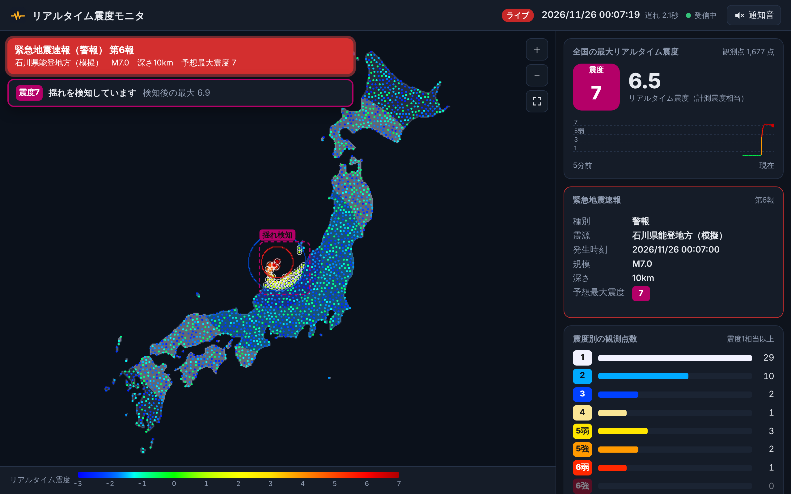

# リアルタイム震度モニタ

防災科学技術研究所（防災科研）の[強震モニタ](http://www.kmoni.bosai.go.jp/)が公開しているリアルタイム震度を、1 秒ごとに地図へ表示する Web アプリです。揺れ検知、緊急地震速報、気象庁の地震情報（[P2P地震情報](https://www.p2pquake.net/)経由）もまとめて見られます。



## できること

- **リアルタイム震度の地図**：全国の観測点の揺れを 1 秒ごとに色で表示します。ホイールやピンチで拡大、ドラッグで移動、ダブルクリックで全体表示に戻ります。観測点にマウスを重ねると値が出ます。
- **全国の最大値**：最大リアルタイム震度と震度階級、直近 5 分の推移、震度別の観測点数を表示します。
- **揺れ検知**：近くの複数の観測点が同時に揺れ始めたら、その範囲を囲んで知らせます。
- **緊急地震速報**：震源・規模・予想最大震度を表示し、推定震度の分布と P 波・S 波の広がりを地図に重ねます。強震モニタに加えて、P2P地震情報の緊急地震速報（警報）も受信します。
- **最近の地震**：気象庁が発表した震源・規模・最大震度・各地の震度・津波の有無を一覧で表示します。
- **過去の揺れの再生**：主な地震の一覧、最近の地震の「再生」ボタン、日時指定のいずれかで、当時のリアルタイム震度を再生できます（一時停止、10 秒送り・戻し、2 倍速）。`?replay=20240101161000` のように URL でも指定できます。
- **通知音**：揺れ検知、震度 3 相当以上への強まり、緊急地震速報、地震情報の受信で音を鳴らします（初期設定はオフ）。
- スマートフォン表示、ダーク／ライト表示（端末の設定に合わせます）。

## 使い方

Node.js 18 以上が必要です。追加のパッケージは不要です。

```bash
npm start
```

ブラウザで <http://localhost:8080/> を開きます。

同じネットワーク内のスマートフォンやタブレットから見るときは、すべてのアドレスで待ち受けるように起動し、`http://<このPCのIPアドレス>:8080/` を開きます。

```bash
HOST=0.0.0.0 npm start
```

| 環境変数 | 既定値 | 内容 |
| --- | --- | --- |
| `PORT` | `8080` | 待ち受けるポート |
| `HOST` | `127.0.0.1` | 待ち受けるアドレス |
| `KMONI_UPSTREAMS` | `http://www.kmoni.bosai.go.jp,https://smi.lmoniexp.bosai.go.jp` | データの取得元（カンマ区切り）。先頭から試し、応答しなければ次を使います |

### 強震モニタに接続できない環境で画面を試す

強震モニタは国外などからは接続できないことがあります。その場合は、本物と同じ形式で合成データを返す模擬サーバーで画面を確認できます（起動から 20 秒後に模擬地震が起き、以後 3 分ごとに繰り返します）。

```bash
npm install
```

```bash
npm run dev:mock
```

模擬データの観測点や地震は架空のもので、本物の強震モニタの地図とは位置が一致しません。

## しくみ

```
ブラウザ ──(同じオリジン)──> server.js ──> 強震モニタ（画像・緊急地震速報 JSON）
   └──────(CORS / WebSocket)──────────> P2P地震情報 API（地震情報・緊急地震速報）
```

- 強震モニタは CORS に対応していないため、`lib/server.js` が中継します。中継できるのは決められた形式のパスだけです。同じ時刻のデータはキャッシュし、閲覧者が何人いても強震モニタへのリクエストは 1 回にまとめます。
- ブラウザは 1 秒ごとにリアルタイム震度の画像を受け取り、各観測点の画素の色を読み取ります。色は HSV に変換し、強震モニタのカラースケールに合わせた多項式でリアルタイム震度（−3〜7）に換算します（`public/js/kmoni.js`）。
- 震度階級は気象庁の境界値（0.5 以上で震度 1、… 4.5 以上で 5 弱、6.5 以上で 7）で決めています。
- 揺れ検知は、観測点ごとに平常時の値をゆっくり追いかけ、そこから 1.0 以上上がって震度 1 相当以上になった観測点が、半径約 150 km 以内に 3 点以上そろったときに検知とします（`public/js/detector.js`）。

## テスト

```bash
npm test
```

色からの換算、画像の解析、揺れ検知、中継サーバー（キャッシュ、上流の切り替え、不正なパスの拒否）、地震情報のまとめ方を確認します。中継サーバーのテストは模擬の強震モニタを相手に動かすので、ネットワークは使いません。

## ファイル構成

| パス | 内容 |
| --- | --- |
| `server.js` | 起動用（`npm start`） |
| `lib/server.js` | 画面の配信と強震モニタの中継 |
| `public/index.html`, `public/style.css` | 画面 |
| `public/js/app.js` | 時刻合わせ、データ取得、画面の更新、再生 |
| `public/js/kmoni.js` | 色 ⇔ 震度の換算、画像解析、時刻・緊急地震速報の解釈 |
| `public/js/mapview.js` | 地図の描画と操作 |
| `public/js/detector.js` | 揺れ検知 |
| `public/js/p2p.js` | P2P地震情報の受信 |
| `public/js/sound.js` | 通知音 |
| `test/` | テストと模擬の強震モニタ |

## ご注意

- 表示する値は、強震モニタの画像の色から読み取った参考値です。リアルタイム震度は気象庁の計測震度を逐次計算できるよう近似したもので、発表される震度とは一致しないことがあります。避難などの判断は、気象庁や自治体の発表に従ってください。
- 強震モニタのデータの利用は、防災科研の定める条件に従ってください。このアプリは個人での閲覧を想定しています。インターネットに公開して不特定多数に配信する場合は、事前に利用条件を確認してください。
- 地震情報と緊急地震速報（警報）は P2P地震情報の API を利用しています。
